# HowlLab — Active Directory d'entreprise (homelab)


## 📌 Présentation du projet

Déploiement d'un Active Directory complet et durci dans un lab virtualisé (VirtualBox), pensé comme un petit SI d'entreprise : un domaine **howl.local**, un contrôleur de domaine assurant AD DS, DNS et DHCP, deux postes clients joints au domaine, une organisation par départements (OU, groupes, GPO), des partages cloisonnés et une politique de sécurité alignée **ANSSI**. La configuration est vérifiée par un script d'audit PowerShell.

**Stack :** Windows Server 2022 · Windows 10 Pro · VirtualBox · PowerShell · GPO · DNS · DHCP

## 🎯 Objectifs

- Déployer un contrôleur de domaine Windows Server 2022 assurant AD DS, DNS et DHCP
- Joindre deux postes clients Windows 10 au domaine
- Organiser les comptes par département (OU, groupes) et appliquer des règles de sécurité par GPO
- Cloisonner les données avec des partages et des droits NTFS au moindre privilège
- Aligner la politique de mot de passe sur les recommandations de l'ANSSI
- Vérifier toute la configuration avec un script d'audit PowerShell

## 🏗 Architecture

<p align="center">
  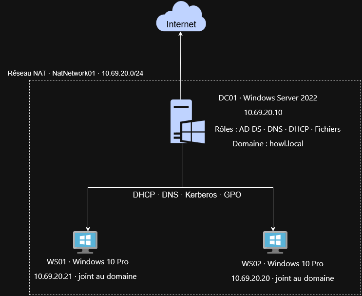
</p>

<p align="center"><i>Lab Active Directory « HowlLab » : 1 contrôleur de domaine et 2 postes clients, isolés sur un réseau NAT VirtualBox 10.69.20.0/24.</i></p>

| Machine | Rôle | OS | IP |
| --- | --- | --- | --- |
| DC01 | Contrôleur de domaine (AD DS, DNS, DHCP, fichiers) | Windows Server 2022 | 10.69.20.10 |
| WS01 | Poste client | Windows 10 Pro | 10.69.20.21 (DHCP) |
| WS02 | Poste client | Windows 10 Pro | 10.69.20.20 (DHCP) |

**Réseau :** NAT VirtualBox `10.69.20.0/24` · passerelle `.1` · DNS `.10` · plage DHCP `.20 → .50`.

## ⭐ Top 5 des preuves

**1. Rôles installés** — Gestionnaire de serveur : AD DS, DNS, DHCP, Fichiers.

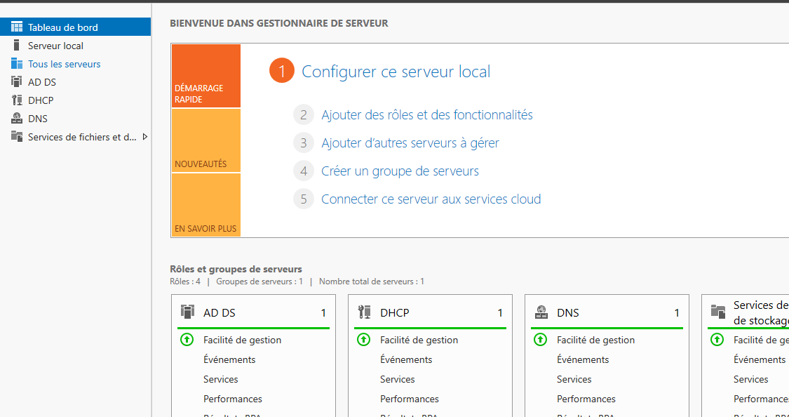

**2. Organisation du domaine** — OU IT, RH, Workstations.

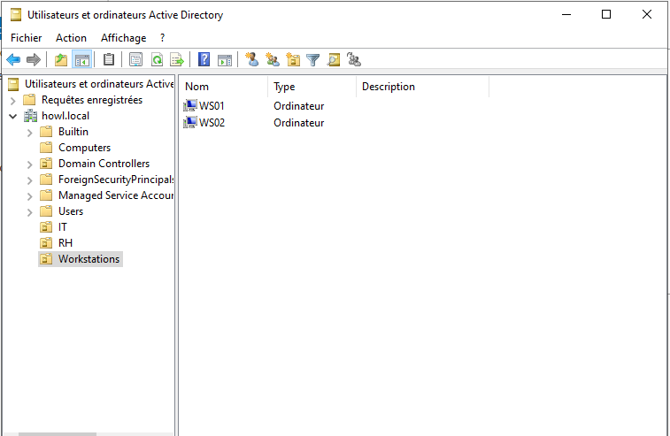

**3. Stratégies de groupe** — console GPO : les 7 GPO et leurs liaisons sur les OU.

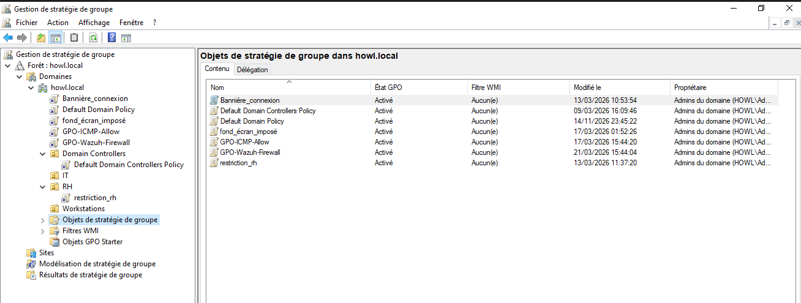

**4. GPO appliquée** — rh.user1 (OU RH) est bloqué sur le Panneau de configuration, alors que Howl1 (OU IT) y accède.

| RH : accès refusé | IT : accès autorisé |
| --- | --- |
| 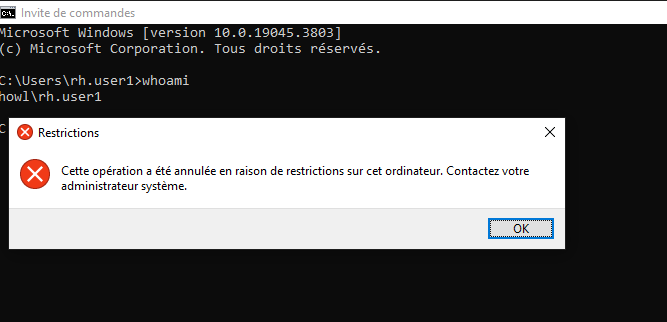 | 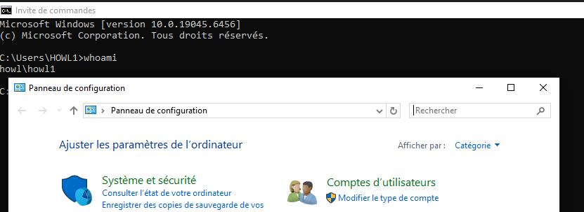 |

**5. Cloisonnement des partages** — accès refusé au dossier IT depuis un compte non autorisé.

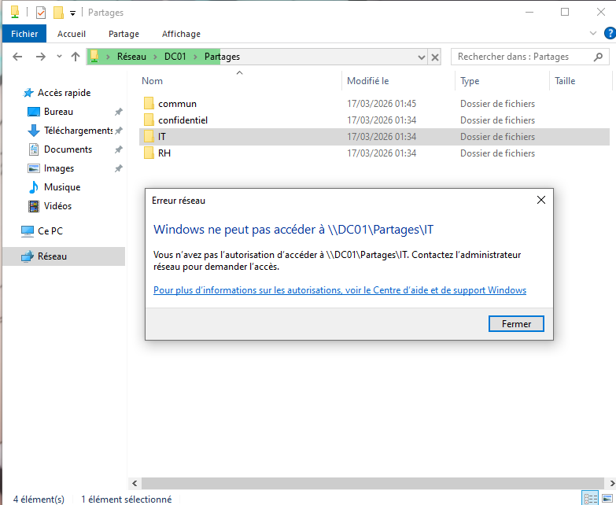

---

## 🔧 Mise en œuvre

Le lab se construit en couches, du socle vers l'utilisateur : on pose d'abord le contrôleur de domaine, puis la distribution des adresses, on raccorde les postes, on organise les comptes, on applique les règles de sécurité, on protège les données, et on termine par les vérifications.

### Phase 1 — Poser le socle (contrôleur de domaine, AD DS et DNS)

- IP fixe `10.69.20.10` sur DC01. DNS de la carte : `10.69.20.10` en premier, `127.0.0.1` en second (bonne pratique Microsoft pour un DC).
- Installation du rôle AD DS, puis promotion en contrôleur de domaine : nouvelle forêt **howl.local**, niveau fonctionnel Windows Server 2016, DNS et catalogue global.

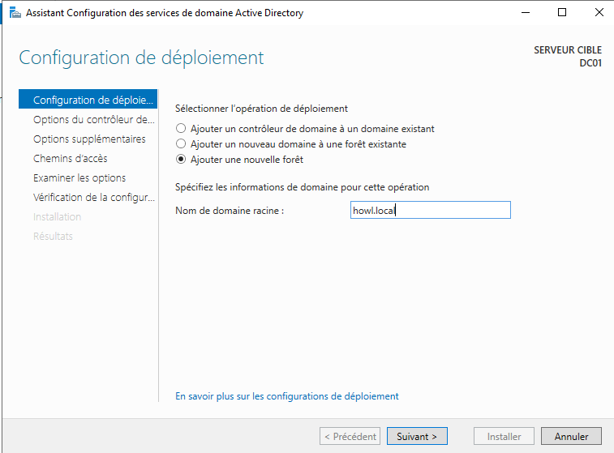

*Création de la forêt howl.local.*

### Phase 2 — Distribuer les adresses automatiquement (DHCP)

- Rôle DHCP installé et autorisé dans l'AD. Le DHCP de VirtualBox est désactivé pour que DC01 soit le seul serveur DHCP du réseau.
- Étendue « HowlLab » `10.69.20.20 → .50`, avec les options passerelle `.1`, DNS `.10` et domaine `howl.local`.
- L'adresse `.50` est réservée au futur serveur SIEM Wazuh (HowlLab — SIEM Wazuh). Pour qu'aucun poste ne la reçoive, on l'exclut de la plage :

```powershell
Add-DhcpServerv4ExclusionRange -ScopeId 10.69.20.0 -StartRange 10.69.20.50 -EndRange 10.69.20.50
```

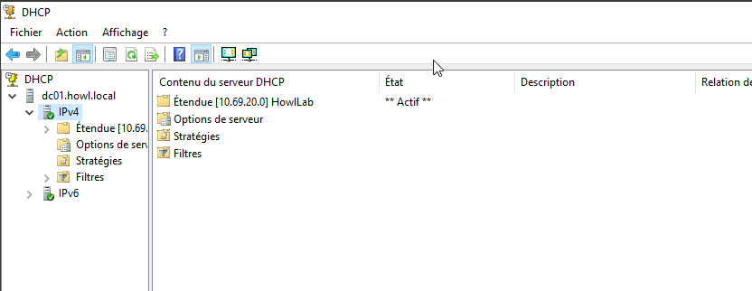

*Étendue HowlLab active.*

### Phase 3 — Raccorder les postes au domaine (jonction des postes)

- WS01 et WS02 reçoivent leur adresse du DHCP de DC01, rejoignent le domaine, puis sont rangés dans l'OU Workstations.

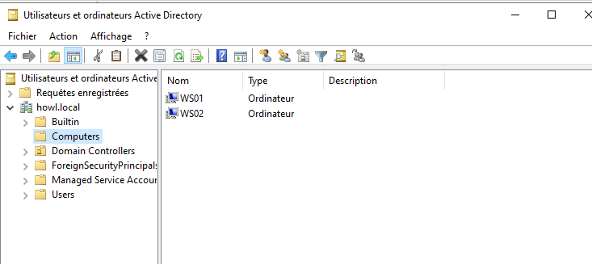

*WS01 et WS02 dans l'annuaire.*

### Phase 4 — Organiser les comptes (OU, utilisateurs et groupes)

| OU | Contenu |
| --- | --- |
| IT | Howl1, Howl2, svc.backup, groupe GRP_IT |
| RH | rh.user1, groupe GRP_RH |
| Workstations | WS01, WS02 |

Les **OU** servent à appliquer les GPO ; les **groupes** servent à donner les droits sur les dossiers. Ajouter un nouvel employé RH revient à le placer dans GRP_RH.

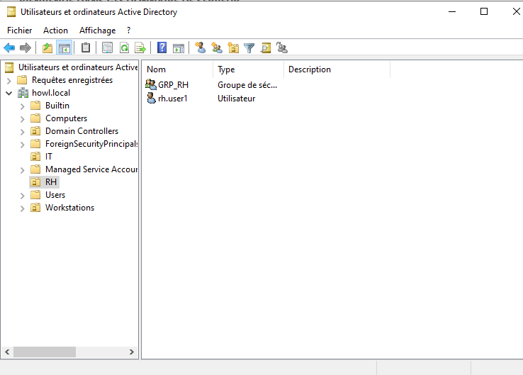

*OU RH avec GRP_RH et rh.user1.*

### Phase 5 — Appliquer les règles de sécurité (GPO)

| GPO | Cible | Effet |
| --- | --- | --- |
| Default Domain Policy | Domaine | Mot de passe 12 caractères + complexité, historique 24, verrouillage après 5 essais pendant 30 min, audit des connexions et des comptes |
| Bannière_connexion | Domaine | Message légal avant l'ouverture de session |
| fond_écran_imposé | Utilisateurs | Fond d'écran imposé depuis le partage `commun` |
| restriction_rh | OU RH | Accès au Panneau de configuration interdit |
| GPO-ICMP-Allow | Domaine | Autorise le ping (ICMPv4 entrant) |
| GPO-Wazuh-Firewall | Domaine | Ouvre les ports 1514/1515 pour l'agent Wazuh (HowlLab — SIEM Wazuh) |

Pas d'expiration périodique des mots de passe pour les comptes standards : depuis 2021, l'ANSSI privilégie la longueur et ne recommande plus le renouvellement forcé.

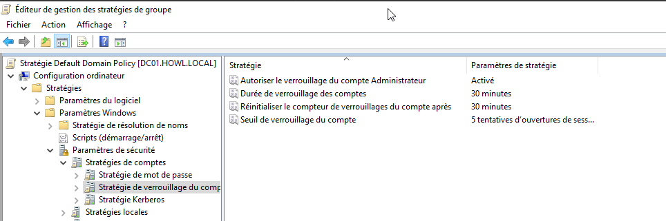

*Stratégie de verrouillage du compte.*

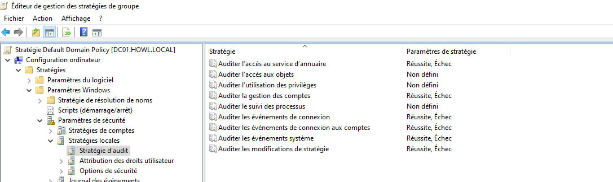

*Stratégie d'audit.*

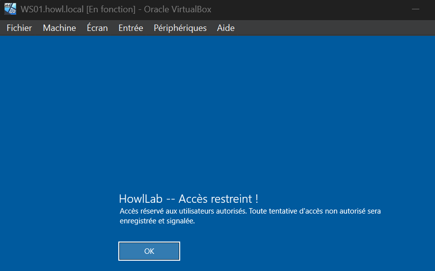

*Bannière affichée sur WS01 avant l'ouverture de session.*

### Phase 6 — Protéger les données (partages et droits NTFS)

Partage `\\DC01\Partages` ouvert aux utilisateurs du domaine ; le cloisonnement se fait par les droits NTFS de chaque dossier.

| Dossier | Accès |
| --- | --- |
| commun | Utilisateurs du domaine : lecture et création de fichiers |
| IT | GRP_IT : Modifier |
| RH | GRP_RH : Modifier |
| confidentiel | Administrateurs uniquement (héritage coupé) |

Les groupes ont le droit **Modifier** et non **Contrôle total** : ils travaillent sur les fichiers sans pouvoir changer les permissions (moindre privilège).

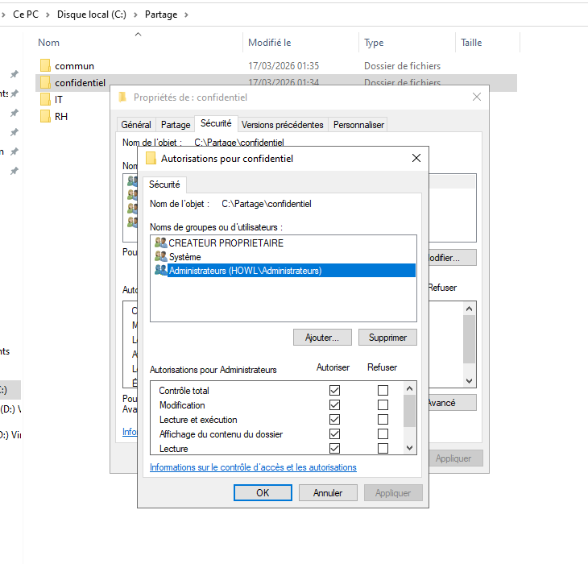

*Droits du dossier confidentiel.*

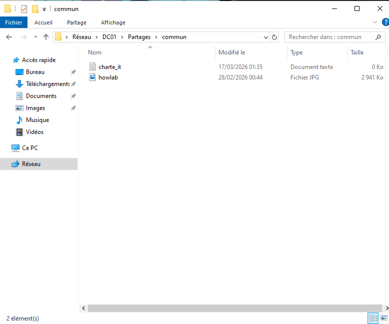

*Dossier commun accessible depuis un poste.*

## ✅ Validation

Tests lancés depuis WS01. Seules les lignes utiles des résultats sont conservées.

**Configuration réseau reçue du DHCP**

```powershell
PS C:\> ipconfig /all
...
Adresse IPv4. . . . . . . . . : 10.69.20.21
Passerelle par défaut. . . . : 10.69.20.1
Serveur DHCP . . . . . . . . : 10.69.20.10
Serveurs DNS . . . . . . . . : 10.69.20.10
...
```

**Lien sécurisé avec le domaine**

```powershell
PS C:\> nltest /sc_verify:howl.local
...
Nom du contrôleur de domaine approuvé \\DC01.howl.local
Statut de la connexion ... Status = 0 0x0 NERR_Success
Vérification de l'approbation Status = 0 0x0 NERR_Success
La commande a été correctement exécutée
```

**Résolution DNS et connectivité**

```powershell
PS C:\> Resolve-DnsName dc01.howl.local
Name              Type   TTL   Section    IPAddress
----              ----   ---   -------    ---------
dc01.howl.local   A      3600  Answer     10.69.20.10

PS C:\> Test-Connection 10.69.20.10 -Count 2
...
WS01   10.69.20.10   10.69.20.10   32   0
WS01   10.69.20.10   10.69.20.10   32   0

PS C:\> Test-Connection 8.8.8.8 -Count 2
...
WS01   8.8.8.8       8.8.8.8       32   5
```

DC01 répond en moins de 1 ms, internet en 5 ms.

**GPO appliquées au poste**

```powershell
PS C:\> gpresult /r /scope computer
...
CN=WS01,OU=Workstations,DC=howl,DC=local
Objets Stratégie de groupe appliqués :
    Default Domain Policy
    Bannière_connexion
    GPO-ICMP-Allow
    GPO-Wazuh-Firewall
```

**Résolution DNS inverse**

```powershell
PS C:\> nslookup 10.69.20.10
...
Nom :    DC01.howl.local
Address: 10.69.20.10
```

L'adresse `10.69.20.10` est bien résolue en `DC01.howl.local` (zone inverse 10.69.20.0/24).

**Audit du contrôleur de domaine**

La configuration du DC est vérifiée par un script d'audit PowerShell en lecture seule, [`scripts/Audit-Projet1.ps1`](scripts/Audit-Projet1.ps1) : domaine, services, DNS, DHCP, OU, comptes, groupes, GPO, partages et `dcdiag`. Extrait des résultats :

```powershell
===== 1. Domaine et foret =====
DNSRoot      DomainMode          ForestMode          PDCEmulator
howl.local   Windows2016Domain   Windows2016Forest   DC01.howl.local

===== 2. Services =====
adws, dhcpserver, dns, kdc, Netlogon, ntds : Running / Automatic

===== 10. Politique de mot de passe =====
MinPasswordLength ComplexityEnabled MaxPasswordAge PasswordHistoryCount LockoutThreshold
12                True              00:00:00       24                   5
```

Tous les services sont actifs et la politique de mot de passe est conforme.

## 🛠 Problèmes rencontrés et solutions

**1. VirtualBox très lent (« native API »)**

- *Symptôme :* VM très lentes, moteur d'exécution « native API », pagination imbriquée inactive.
- *Cause :* la sécurité basée sur la virtualisation de Windows 11 (VBS, maintenue par KeyGuard) occupait l'hyperviseur et privait VirtualBox d'un accès direct à AMD-V.
- *Solution :* désactivation de l'intégrité de la mémoire, `bcdedit /set hypervisorlaunchtype off`, puis désactivation de la VBS avec l'outil Microsoft *DG Readiness Tool*. Résultat : moteur VT-x/AMD-V et pagination imbriquée actifs.

**2. Mise à jour qui plante le DC (boucle à 74 %, erreur 0xc000021a)**

- *Symptôme :* la mise à jour cumulative KB5126655 figeait DC01 au redémarrage, en boucle.
- *Solution :* annulation des opérations en attente depuis l'environnement de récupération, puis blocage temporaire de Windows Update.

```txt
dism /image:D:\ /cleanup-image /revertpendingactions
```

**3. Profil réseau du DC en « Public »**

- *Symptôme :* icône « pas d'accès internet » et profil réseau Public, donc règles de pare-feu les plus strictes.
- *Cause :* au démarrage, le service de détection réseau (NLA) cherche le contrôleur de domaine via le DNS. La carte n'avait que `127.0.0.1` comme DNS, interrogé avant que le service DNS soit prêt : la détection échouait et le réseau restait en Public. Un premier correctif (démarrage différé seul) ne tenait pas au redémarrage.
- *Solution :* IP réelle du DC en DNS principal, NLA en démarrage différé, et NLA configuré pour attendre le contrôleur de domaine. Résultat : profil `DomainAuthenticated` stable après redémarrage.

```powershell
Set-DnsClientServerAddress -InterfaceAlias "Ethernet" -ServerAddresses 10.69.20.10,127.0.0.1
sc.exe config NlaSvc start= delayed-auto
New-ItemProperty -Path "HKLM:\SYSTEM\CurrentControlSet\Services\NlaSvc\Parameters" -Name AlwaysExpectDomainController -PropertyType DWord -Value 1 -Force
```

**4. Erreur d'autorisation DHCP au démarrage**

- *Cause :* le service DHCP démarre avant l'AD et ne peut pas vérifier son autorisation.
- *Solution :* démarrage différé du service DHCP (`sc.exe config dhcpserver start= delayed-auto`).

**5. Conflit d'adresse avec le SIEM**

- *Cause :* l'IP fixe du serveur Wazuh (`.50`) se trouvait dans la plage DHCP.
- *Solution :* exclusion de `.50` de la plage (voir Phase 2).

## 📊 Résultats

- Domaine **howl.local** opérationnel : AD DS, DNS (zones directe et inverse) et DHCP actifs sur DC01
- WS01 et WS02 joints au domaine, adresse reçue du DHCP, lien sécurisé vérifié (`NERR_Success`)
- GPO appliquées et vérifiées avec `gpresult` : restriction RH effective, bannière et fond d'écran imposés
- Partages cloisonnés : accès refusé hors du bon groupe, dossier confidentiel réservé aux administrateurs
- Politique de mot de passe conforme ANSSI : 12 caractères, complexité, historique 24, verrouillage après 5 essais
- Profil réseau du DC `DomainAuthenticated` stable après redémarrage

## 📘 Ce que j'ai appris

- Un problème d'infrastructure se diagnostique couche par couche : hyperviseur, système, réseau, puis service.
- L'ordre de démarrage des services compte sur un contrôleur de domaine.
- Toujours prendre un snapshot avant une mise à jour ou une manipulation risquée.
- Les OU et les groupes n'ont pas le même rôle : les premières portent les GPO, les seconds les droits.

## 🧠 Compétences démontrées

Active Directory (AD DS, OU, comptes, groupes) · DNS (zones directe et inverse) · DHCP · GPO · Droits NTFS et partages · PowerShell (administration et audit) · Virtualisation VirtualBox · Diagnostic Windows (DISM, NLA, VBS)

## 🚀 Feuille de route

- [x] HowlLab — Active Directory d'entreprise : terminé le 15/11/2026
- [ ] HowlLab — SIEM Wazuh : déploiement du serveur sur Ubuntu, agents sur DC01, WS01 et WS02, tableaux de bord et premiers tests
- [ ] HowlLab — Purple Team : attaque et détection de l'AD avec Wazuh, les comptes de ce lab serviront de cibles
